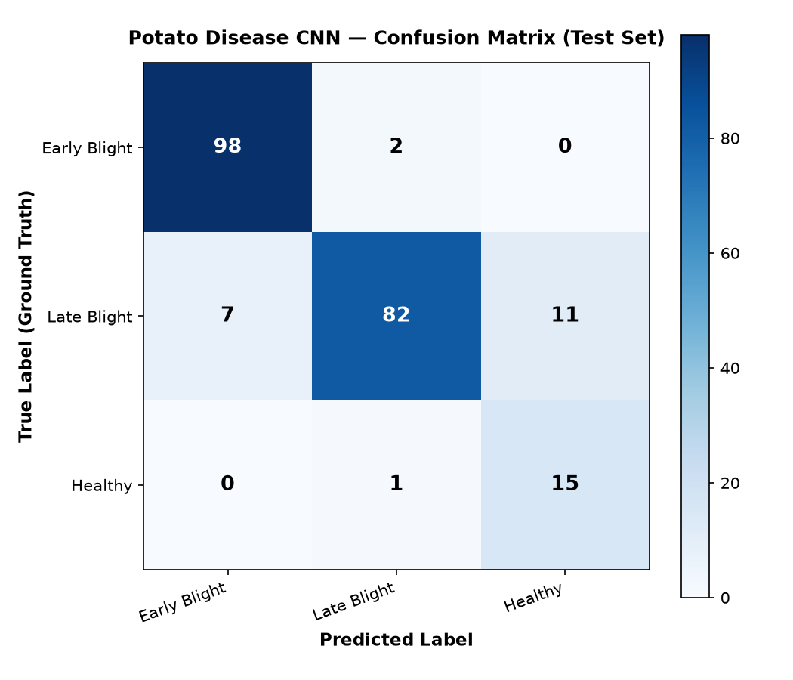

# Smart Agro-Vision: Potato Leaf Disease Identification & Classification

An end-to-end Deep Learning and MLOps system to detect, classify, and provide actionable agronomic treatments for potato leaf diseases using Convolutional Neural Networks (CNN).



---

## 🌟 Key Features

- **Custom 4-Block Deep CNN**: Engineered with Conv2D, Batch Normalization, ReLU, MaxPooling2D, Dropout regularization, and Global Average Pooling (< 1.7 MB footprint, 424K parameters).
- **Class-Imbalance Handling**: Balanced class weighting applied during training to counter minority class underrepresentation.
- **Robust Pipeline**: Automated KaggleHub ingestion, stratified 80/10/10 split, and real-time data augmentation.
- **FastAPI REST API**: High-throughput backend offering `/health` and `/predict` endpoints with Swagger documentation.
- **Streamlit Web Dashboard**: Farmer-friendly UI featuring drag-and-drop upload, camera capture, real-time probability distributions, and tailored disease remedies.
- **Dockerized Deployment**: Multi-service `docker-compose.yml` for unified frontend and backend deployment.
- **Agile & Academic Documentation**: Complete Jira sprint backlog (`docs/jira_backlog.md`), technical report (`docs/final_report.md`), and presentation deck (`docs/presentation_deck.md`).

---

## 📊 Dataset Overview

The dataset is sourced from PlantVillage (`aarishasifkhan/plantvillage-potato-disease-dataset`) via KaggleHub, containing **2,152 verified RGB images** ($256 \times 256$ resolution):

- **Early Blight** (*Alternaria solani*): 1,000 images
- **Late Blight** (*Phytophthora infestans*): 1,000 images
- **Healthy Foliage**: 152 images

### Stratified Dataset Split
| Split | Early Blight | Healthy | Late Blight | Total Images |
| :--- | :---: | :---: | :---: | :---: |
| **Train (80%)** | 800 | 121 | 800 | **1,721** |
| **Val (10%)** | 100 | 15 | 100 | **215** |
| **Test (10%)** | 100 | 16 | 100 | **216** |

---

## 📈 Model Performance & Results

Evaluated on the completely unseen test partition (216 images):

- **Test Accuracy**: **90.28%**
- **Test Loss**: **0.223**
- **Macro F1-Score**: **0.852**

### Per-Class Metrics
| Class | Precision | Recall | F1-Score | Support |
| :--- | :---: | :---: | :---: | :---: |
| **Early Blight** | 93.3% | 98.0% | **0.956** | 100 |
| **Late Blight** | 96.5% | 82.0% | **0.887** | 100 |
| **Healthy** | 57.7% | 93.8% | **0.714** | 16 |

Diagnostic curves and visual reports can be found in `reports/figures/`:
- `reports/figures/training_curves.png`: Training vs. Validation Loss and Accuracy.
- `reports/figures/confusion_matrix.png`: Normalized confusion matrix.
- `reports/figures/augmentation_samples.png`: Sample transformations preview.

---

## 🗂️ Project Directory Structure

```text
deep project/
├── api/
│   └── app.py                     # FastAPI REST API backend
├── app/
│   └── streamlit_app.py           # Streamlit Web UI dashboard
├── data/
│   ├── raw/PlantVillage/          # Original downloaded images (gitignored)
│   └── processed/                 # Train / Val / Test partitions (gitignored)
├── docs/
│   ├── final_report.md            # University-standard technical report
│   ├── jira_backlog.md            # Agile Scrum sprint backlog & tickets
│   └── presentation_deck.md       # Final defense presentation slide deck
├── models/
│   ├── .gitkeep
│   └── best_potato_cnn.keras      # Saved trained model checkpoint
├── reports/
│   ├── evaluation_results.json    # Test metrics and confusion matrix data
│   ├── training_history.csv       # Epoch-by-epoch loss and accuracy log
│   └── figures/                   # Evaluation plots and visual artifacts
├── src/
│   ├── config.py                  # Global hyperparameters and directory paths
│   ├── data_split.py              # Stratified train/val/test splitter
│   ├── dataset_pytorch.py         # PyTorch DataLoader pipeline
│   ├── evaluate.py                # Test set evaluation and metric plotting
│   ├── model.py                   # CNN architecture definition
│   ├── preprocess.py              # tf.data pipeline & class weight calculation
│   ├── remedies.py                # Agronomic treatment recommendations
│   ├── train.py                   # Training loop with callbacks
│   └── visualize_augmentation.py  # Visual augmentation generator
├── docker-compose.yml             # Multi-container orchestration
├── Dockerfile                     # Multi-stage production container build
├── download_data.py               # KaggleHub automatic dataset ingestion
├── explore_data.py                # Dataset audit and shape inspection
├── requirements.txt               # Pinned Python package dependencies
└── README.md
```

---

## ⚡ Quickstart Guide

### 1. Environment Setup
```powershell
# Clone the repository
git clone https://github.com/abrham536/potato.git
cd potato

# Create and activate virtual environment
python -m venv .venv
.venv\Scripts\activate   # Windows
# source .venv/bin/activate # Linux / macOS

# Install dependencies
pip install -r requirements.txt
```

### 2. Dataset Ingestion & Preprocessing
```powershell
python download_data.py
python src/data_split.py
```

### 3. Model Training & Evaluation
```powershell
python src/train.py
python src/evaluate.py
```

### 4. Running the Applications

#### Option A: Local Execution
Run the FastAPI backend in one terminal:
```powershell
uvicorn api.app:app --host 0.0.0.0 --port 8000 --reload
```
Interactive API documentation: `http://localhost:8000/docs`

Run the Streamlit dashboard in a second terminal:
```powershell
streamlit run app/streamlit_app.py
```
Dashboard UI: `http://localhost:8501`

#### Option B: Docker Compose
```powershell
docker compose up --build
```

---

## 📜 License & Acknowledgments

- **Dataset**: [PlantVillage Potato Disease Dataset](https://www.kaggle.com/datasets/aarishasifkhan/plantvillage-potato-disease-dataset)
- **Institution**: Debre Berhan University — College of Computing, Department of Computer Science
